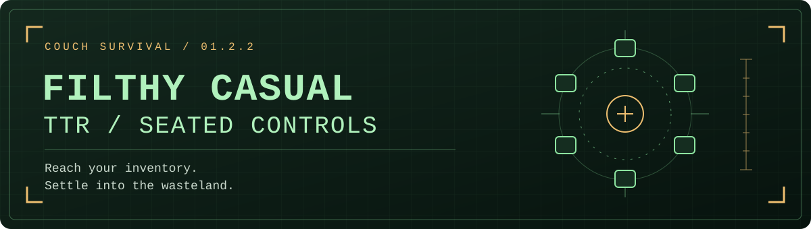

<p align="center"></p>

# Filthy Casual TTR

**We love A Tale of Two Realities. We're just filthy casuals.**

Can't be bothered to reload? Tired of digging for snacks? Stay seated.

Reach out to choose a weapon or aid item, let TTWVR put it in your right hand,
and set a comfortable seated eye height. An independent addon for an existing
**Tale of Two Wastelands VR** installation.

**Revision 1.4.4 · Beta.** Modified thumbrest double taps open the
selectors; left Menu tap/hold changes reload mode or opens seated settings.
Empty hands have smooth thumb and index gestures. Physical-headset acceptance
of this revision and an updated guide video remain pending.
Graphics tuning (DLSS, anti-aliasing, resolution, or reprojection) is separate
from this addon and is not included in its package.

[Download the MO2 ZIP](https://github.com/nikamigaming-create/filthy-casual-ttr/releases/tag/v1.4.4) · [Meta Link companion mod](https://github.com/nikamigaming-create/ttr-meta-link)

## Install through Mod Organizer 2

Start with **TTWVR already working in VR**, including its xNVSE and JIP LN NVSE
requirements. This addon supports one exact TTWVR build; check the
[supported DLL and detailed installation guide](docs/INSTALL.md).

1. In MO2, choose **Install a new mod from an archive** and select
   `Filthy-Casual-TTR-1.4.4.zip`.
2. Install it as **Filthy Casual TTR** and tick its checkbox in the left pane.
3. Place it **below the base TTWVR mod in the left pane**, so the addon has higher
   file priority. Keep the base TTWVR mod enabled.
4. Start your headset/runtime as usual, then run your **existing TTWVR executable
   entry through MO2**.

The plugin discovers its companion OpenXR layer inside the running game process.
No separate addon launcher, global layer registration, or runtime change is
required. The archive contains the addon, documentation, and license notices.

## Reach, touch, equip

Keep your opposite thumb resting on its stick, then **double-tap the right thumbrest**
for weapons or **double-tap the left thumbrest** for consumables. No stick click.
The selector stays where you opened it,
with compact previews arranged within reach. Touch an item with **either hand**;
the selected item goes to the **right hand at its native game size**, and the
selector closes.

| Action | Control |
| --- | --- |
| Open weapons | Keep **left stick touched**, **double-tap right thumbrest** |
| Open aid | Keep **right stick touched**, **double-tap left thumbrest** |
| Choose an item | Touch its preview with either hand |
| Select nothing / clear your hand | Touch the large center bottle cap |
| Holster the drawn weapon | Touch that weapon in the selector again |
| Reload the right-hand gun | A, with the selector and height panel closed |
| Switch manual / automatic reload | Tap **left Menu**; a message confirms the mode |
| Return holding control to TTR | Squeeze the right grip once |
| Run | Push the left stick fully in the movement direction; no click needed |
| Change page | A / X |
| Close the selector | B, or move away |
| Open seated-height settings | Hold **left Menu** for **1 s** |

The thumbrests are the small touch-sensitive resting pads, not the thumbsticks
or face buttons. Keep the opposite stick touched throughout two short taps.
The wheel opens on the second contact; simply resting there never opens it.
Both rests together, loss of the opposite stick contact, and tracking/menu
interruptions cancel an unfinished sequence. `[Controls] DoubleTapMs=450` sets
the gap allowed between taps (200–700 ms). `HoldMs=1000` controls Menu only.

A short left Menu press toggles reload **on release**. A full hold opens settings
and never also toggles reload. These actions are available during gameplay with
our panels closed. **Left Menu already has a native TTR binding; this intentionally
replaces it during gameplay.** It passes through in native menus. Y Pause and
all standalone face buttons retain native input without the previous combo delay.
Triggers, grips, movement and stick clicks retain their normal gameplay bindings.
Inside the selectors/settings, the displayed panel controls apply. No wrist cuff.

Both selectors open 60 cm ahead of your head and stay fixed in the world.
Adjust `[Selector] ForwardCm` in `SeatedControls.ini` for your seated reach;
placement changes apply at the next game launch. Compact previews keep their size.

An item already touching your resting hand when the selector opens is ignored
until you move away and touch it again. Weapon changes use TTWVR's own
holster/equip/draw handoff. The selected item stays held without a grip press.
A deliberate right-grip squeeze gives holding control back to TTWVR for guns,
food, ordinary aid, and live Stimpaks. Release then follows that native item's
behavior. For guns this also cancels automatic redraw after menus. Selecting
another item starts the convenience hold again.

If a native menu holsters your selected gun, the addon requests its normal draw
again when gameplay and combat controls return, provided the same gun is still
equipped. The center cap and touching the drawn gun again cancel that selection.
This selection memory lasts only for the current session; it adds no save data.

The center cap appears on every page, including empty inventory categories.
Touch it to holster a drawn weapon or return held aid through the native stow
path, without consuming it. It is a preview of the game's own bottle-cap model;
it does not spend or require any currency. Its default diameter is 12 cm,
adjustable with `CenterCapSizeCm` in `SeatedControls.ini`.

### Aid stays native

**Stimpaks:** select one, then use TTWVR's live-Stimpak action: hold the right
trigger and stab into the body. Selecting a Stimpak alone does not consume it.

**Other aid:** selection puts an ordinary native grabbed item in your right hand.
Squeeze and release the right grip to drop it, or release over a shoulder to stow
it in the backpack. Selecting another item also returns the held item to inventory.
The addon does not intercept Y or add a separate consume command. Native item
use remains TTR's responsibility. Ordinary food consumption through its held-item
path has not yet been verified; the current hold-A check returned it to inventory.
Y remains native Pause outside our panels. The height panel keeps its own Y
popup-toggle action. Quest aid is excluded from the selector.

Menu/dialogue suspension retains the selected item's grip signal instead of
manufacturing a release. Deliberately squeezing and releasing grip still hands
release/drop/stow behavior back to TTWVR. Nothing is automatically recovered
from the ground or added to inventory.

## Natural empty-hand gestures

Lift your thumb off the rest, stick and both face buttons to release it. Close
an empty hand with grip while your index rests on the trigger for a thumbs-up;
you do not need to pull the trigger. With the grip open, the thumb rests softly.
With thumb contact and grip squeezed, it folds inward against the curled fingers.
Grip plus index contact makes a fist; lifting the index off the trigger allows
pointing. Trigger pull remains an independent index curl. Transitions are smooth.
The three other fingers use native grip animation. While either wheel or settings
is open, free-hand animation still reads the physical squeeze, even though gameplay
grabbing is blocked. Held-item and weapon-support poses remain native. These are controller-driven
gestures, not independent five-finger tracking.

Each free hand articulates independently, including the left hand while the right
holds a gun or consumable. Native weapon/support grips, grabbed items, Stimpaks
and per-hand transitions retain TTR's own poses.
Set `[Hands] FingerGestures=0` in the INI and restart to use only TTR's original
finger animation. No hand meshes, saved games, or item records are replaced.

## Reload your way

Automatic reload is the default. Native A/X gun actions remain available outside
our panels, without a face-button recognition delay. Tap **left Menu** to switch the native
manual/automatic setting; a message confirms the actual mode. The choice is
remembered. A still calibrates height or changes pages when those panels are
open; B remains close/back.

Manual mode uses TTR's reload system. The addon positions its native ammo pouch
in seated reach, anchored to the torso rather than your gaze. Look down toward
your lap. Defaults are 25 cm forward, centered, and 45 cm below eye height.
The native pouch controls visibility and magazine handling.

In `NVSE/Plugins/SeatedControls.ini`, `[Weapons] AutomaticReload=0` starts in
manual mode; `1` starts in automatic mode. `SeatedAmmoPouch=0` preserves TTR's
own pouch position. `PouchForwardCm`, `PouchSideCm`, and `PouchBelowEyesCm`
adjust seated placement. Restart after editing the INI. Turning automatic mode
back on restores the prior native pouch placement for that session. This does
not write TTR's SavedPouch file.

## Set your seated height

Sit comfortably and look forward. Hold **left Menu** for one second,
release it, press **A** to calibrate, then **B** to save and close.

| While the height panel is open | Result |
| --- | --- |
| A | Calibrate to the target eye height; default **165 cm** |
| Right stick up / down | Adjust by **5 cm** |
| X | Reset the height offset |
| Y | Toggle selector popups on / off; remembered immediately |
| B | Save and close |

Selector hints and selection/dismissal notices default to **off**. To see them,
hold **left Menu** to open this panel and press **Y**. **All height messages stay
on**, including calibration, adjustment, reset, and saving. The equivalent INI
setting is `[UI] ShowSelectorPopups=0` (quiet) or `1` (show). This controls the
addon's messages, not notifications from the game or other mods.

A fresh installation starts at zero offset. If you previously added a seated
height offset in SteamVR or another runtime tool, reset that offset first if you
want this addon to handle the entire adjustment. See the
[installation guide](docs/INSTALL.md) for updates, troubleshooting, and removal.

## Guide

Use the illustrated overview and controls above for this beta. An updated video
is still in preparation; older footage shows superseded controls. There is no
addon Y-consume action.

The selector adds no save hooks, custom co-save data, or inventory recovery.
Saving and native held-item behavior remain with the game and TTWVR.

## For contributors

Build from the source checkout with Visual Studio 2022 Build Tools, the Desktop
development with C++ workload, and a Windows SDK:

```bat
build.cmd
```

The build discovers Visual Studio using `vswhere`; `SC_VCVARS32` can point to a
specific `vcvars32.bat`. Both addon DLLs target x86 to match `FalloutNV.exe`.
Run `package.ps1` after building to produce the MO2 ZIP. Packaging uses an explicit
file list and records hashes in `manifest.json`; it does not publish anything.

The public source includes focused control and input-layer tests. The private
development simulator, raw captures and machine-specific launchers are excluded.
See `docs/VALIDATION.md` for the release's tested behavior and remaining limits.

This is an independent community project, not an official Fallout release.
Built on KUPOkinz's A Tale of Two Realities / TTWVR. The base mod supplies the
VR experience; this addon supplies a little more couch comfort.
Game assets and dependency binaries are not included. Third-party notices and
licenses are retained; see [THIRD_PARTY.md](THIRD_PARTY.md).

## Illustrated overview


The artwork is illustrative. It is not a gameplay screenshot.

