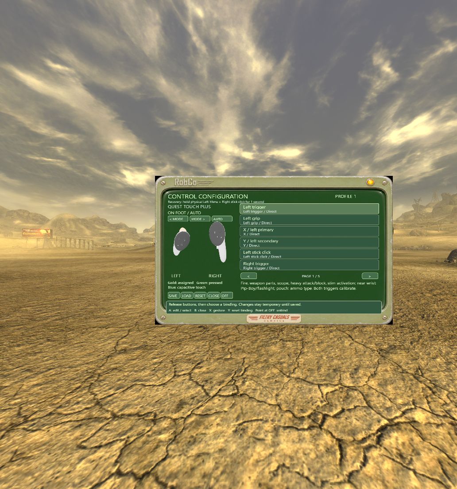
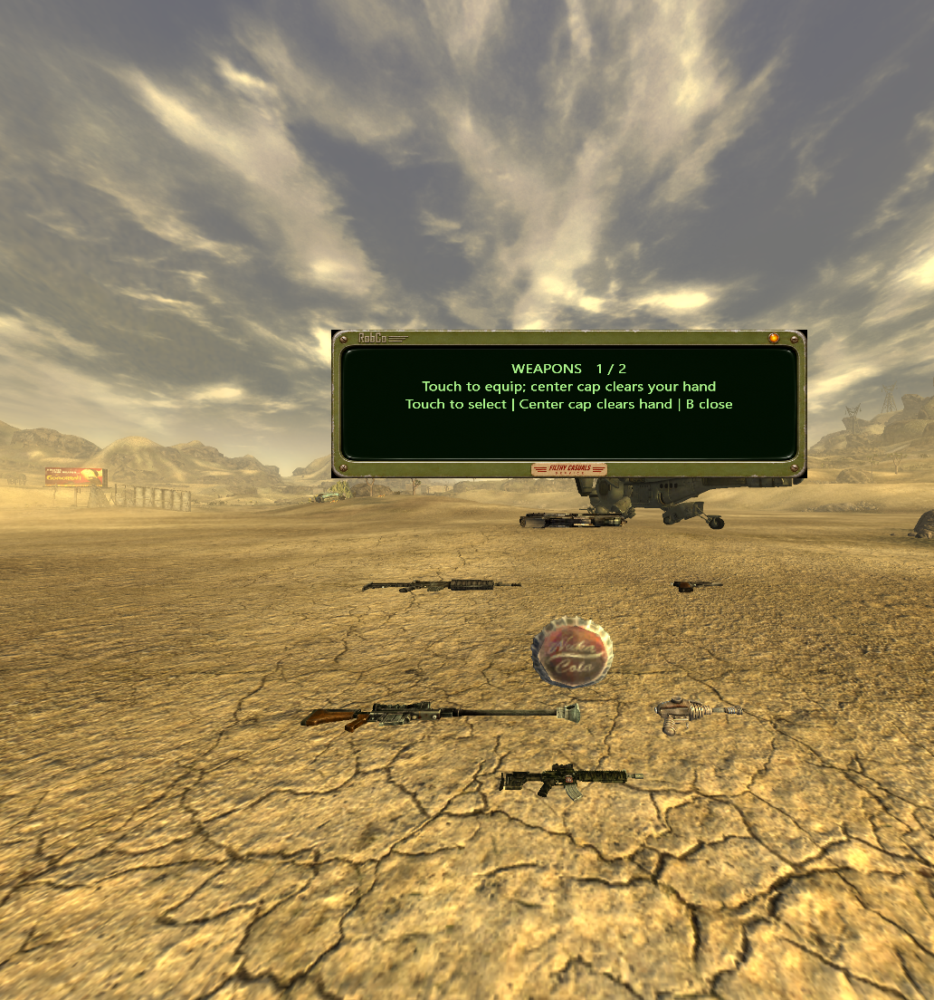
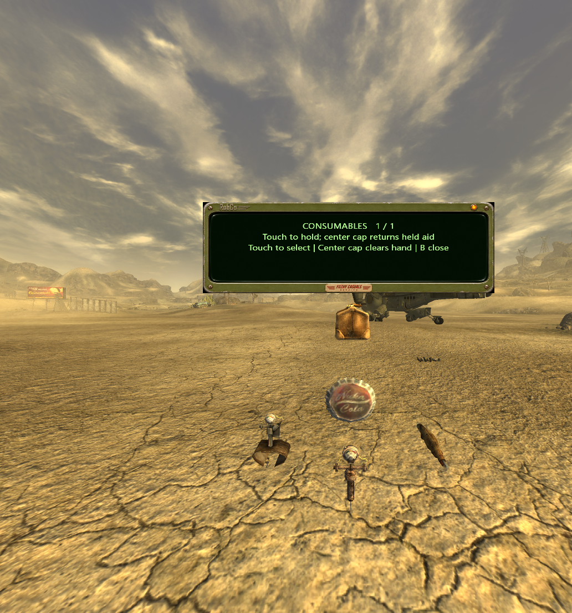
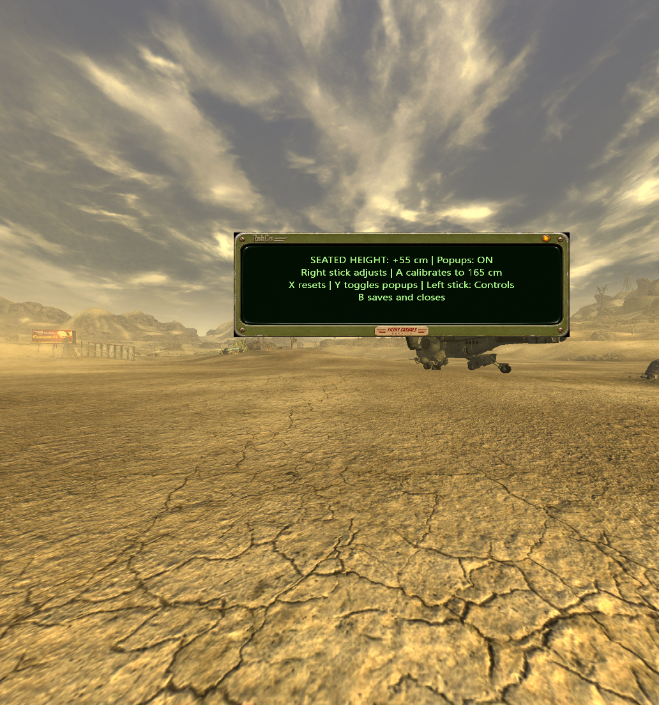
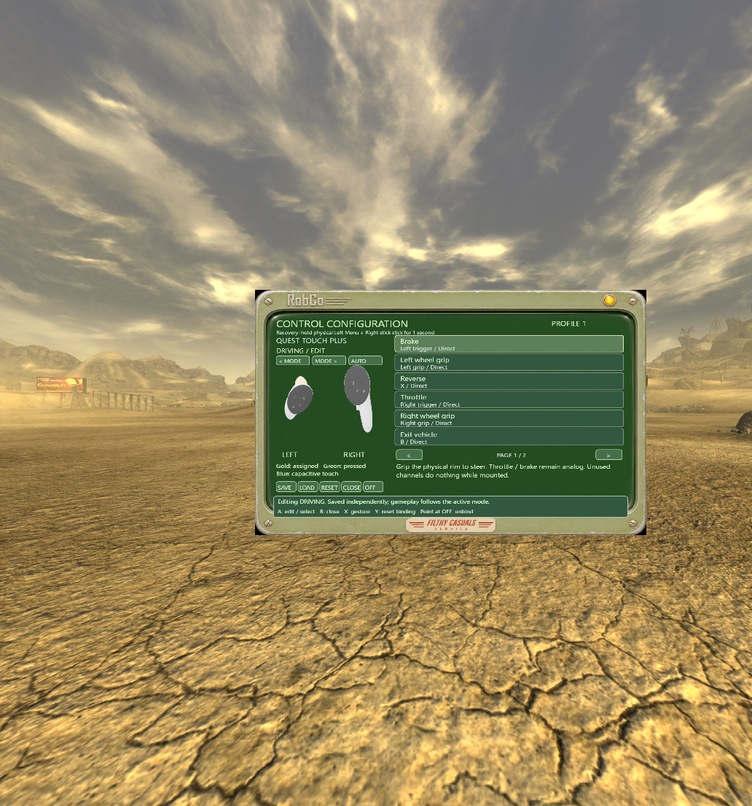
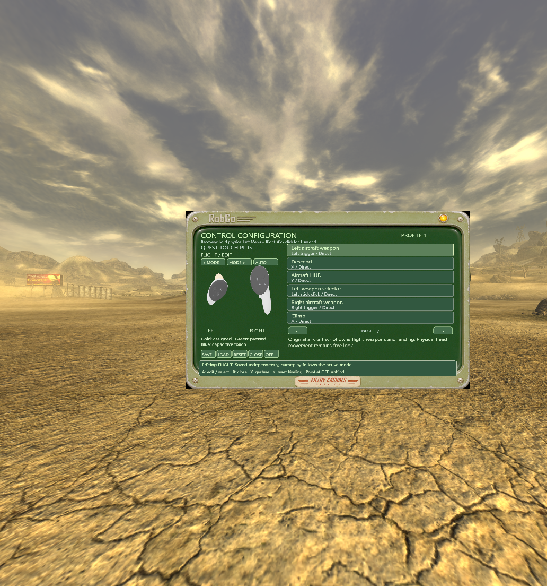

<p align="center"></p>

# Filthy Casual TTR

**We love A Tale of Two Realities. We're just filthy casuals.**

Pick a weapon. Grab a snack. Set your seated height. Keep TTR's normal interactions.
Filthy Casuals adds comfort and control tools to an existing **Tale of Two Wastelands VR** installation.

**1.7.0-dev.1 · RobCo controls candidate · updated 13 November 2026**

[⬇ Downloads](https://github.com/nikamigaming-create/filthy-casual-ttr/releases) · [⚙ Install](docs/INSTALL.md) · [🎮 Controls](docs/CONTROLS-EDITOR.md) · [⌨ Offline editor](tools/controls-editor.html) · [Validation](docs/VALIDATION.md)

[One-page illustrated field manual](docs/assets/filthy-casual-field-manual.png) covers the current beta, including optional vehicles and bottle impacts. The release includes the core ZIP; vehicles remain a separate optional addon with local asset preparation.

This build requires **TTR 1.1.5** with the exact DLL hash in [Install](docs/INSTALL.md). For the previous TTR 1.1.2 host, use [beta 1](https://github.com/nikamigaming-create/filthy-casual-ttr/releases/tag/v1.8.0-beta.1). Update core and Vehicles together when both are installed.

## Your controls, your couch



The in-game editor displays real 3D Quest Touch Plus controllers. Point at an
entry, record a button or two-input combo, review it and apply. Choose Direct,
Press, Tap, Hold or Double tap; save one of **eight profiles**. Physical finger
animation remains independent of remapped gameplay inputs.

**Open:** hold left Menu, then click the left stick in Height/settings.
**Recovery:** hold physical left Menu + right stick click for one second.
Recovery stays available even after changing your normal bindings.

| What you can configure | What it does |
| --- | --- |
| Buttons, triggers, grips, stick directions and touch sensors | Assign any exposed physical input to an available destination |
| Weapon / consumable wheels, reload mode, height and tutorial | Separate Filthy Casuals shortcuts |
| On foot / driving / flight | Independent bindings in each saved profile; automatic gameplay switching |
| Installed providers | Addons advertise their modes and channels; configure them without mounting a vehicle |
| Offline profiles | Open the local HTML editor, import the installed catalog and profile, edit and download |

TTR shares some input channels between actions: Trigger can mean fire, operate
a part, use a scope or activate a held item. Those uses move together and are
listed together. Holster reaches, magazine insertion, throwing and other spatial
interactions remain native. Quest's system Home button belongs to the headset.
[Full editor guide](docs/CONTROLS-EDITOR.md) · [Addon provider API](docs/CONTROLS-PROVIDERS.md).

## Reach, touch, equip



Hold the opposite thumb on its **separate thumbrest** and double-tap the right
thumbrest for weapons, or the left for consumables. These are the small resting
pads, not the sticks. On foot, the selector stays where you opened it. In a vehicle, it travels with the cabin. Touch a compact
preview with either hand: the native item replaces what is in your **right hand**
at its normal size. Touch the center cap to select nothing; B closes the wheel.



Selection does not consume an item. Stimpaks retain TTR's trigger-and-body-stab
interaction. In our sticky holding mode, food, drinks and other ingestibles can
be brought from away from your face to your mouth and held there for about 0.65 seconds; A/X returns it to inventory. Squeeze the right grip
once to return the item to native holding, release, throw and backpack behavior.
Native interactions and your normal save system continue to own the item.

| Default shortcut | Action |
| --- | --- |
| Opposite thumbrest held + double-tap right thumbrest | Weapons |
| Opposite thumbrest held + double-tap left thumbrest | Consumables |
| Left Menu tap | Manual / automatic reload toggle |
| Left Menu hold | Seated-height settings |
| Left Menu triple tap | Optional weapon tutorial |
| Right grip squeeze with our selected item | Return to native holding |
| Y | Native Pause |

Face buttons keep their normal native gameplay behavior outside our panels.
Left Menu intentionally replaces its native gameplay shortcut; it passes through
in native menus. Conflicting custom assignments are shown, never silently stolen.

Recovered compatible native magazines can be inserted into the gun again or
returned to the native ammo pouch. In manual mode, inserting into an empty gun does not chamber a round: cycle its native slide or bolt before firing. [Setup and tested coverage](docs/PHYSICAL_PARTS.md).

## Set your height once



Sit comfortably, hold left Menu, press A to calibrate and B to save. Right stick
adjusts the offset. **Your seated height is restored next launch.** Ground, car, flight, Bighorner and Deathclaw offsets are saved separately. **** Y toggles
routine popup hints; height messages remain available. Height, selector labels,
reload notifications, controls and tutorial cards share the RobCo motif.

## Empty bottles and impact breakage

Drinking a supported bottled drink in sticky-hand mode leaves its original-game
empty bottle in the right hand. Squeeze to return to normal TTR handling, then
pick up, drop, throw or backpack it normally. Native drink effects are unchanged.
Whiskey, Scotch, Nuka-Cola variants and Sunset Sarsaparilla use their matching
owned-game empty models; unknown containers keep their native behavior.

Tracked empty bottles break only after a real Havok contact with a sufficiently
strong relative velocity change. Airborne speed alone, gentle drops and held
bottles do not qualify. The local candidate uses original glass decal artwork
with native projection/fading, a small native particle puff and positional glass
sound. The glass fades out through the native timed-decal path after about
10 seconds. Gentle drop, hard ground throw, three sign impacts and fade-out are
recorded with real game audio. Not in public 1.7.0-dev.1 yet. A headset report exposed a consumed-bottle
render/physics handoff failure; the correction is now installed locally and passes four-family simulator checks.
Your real headset throw remains the final acceptance check.
Enable the included `Filthy Casual Glass.esp` in MO2's Plugins tab for this build.
See [bottle impact details](docs/bottle-impacts.md).

## Driving and flight are optional





The separate Vehicles beta addon advertises car and aircraft controls.
The core seated mod needs neither Vehicles nor Pool. When installed, its modes
appear before entering a vehicle; the active profile follows boarding and exit.

- **Roadster:** left stick up/down drives forward/reverse;
  right stick left/right steers. Pulling against motion brakes before reversing. Neutral slows the car. Either/both hands can
  grip the rim; both triggers remain native for guns and items. B exits.
- **Vertibird:** right-stick movement, left-stick heading, A climb, X descend,
  B land, Y aircraft HUD, triggers for aircraft weapons and stick-click selectors.

Vehicle source and local asset-import instructions are in [vehicle-vr](vehicle-vr/README.md).
Its native dependencies are separate downloads: [Uhmatt Drivable Cars](https://www.nexusmods.com/newvegas/mods/63890),
[Vertibird Player Home and TTW patch](https://www.nexusmods.com/newvegas/mods/60923),
and [Pilot Inside](https://www.nexusmods.com/newvegas/mods/100171).
This is a development integration, not a bundled turnkey vehicle release.
The selected classic aircraft uses locally owned New Vegas assets; Fallout 4 is
not required. No original game or dependency meshes/textures are distributed.

[Pool](pool-vr/README.md) remains a separate optional addon and is not enabled by
this release. [Meta Link helper](https://github.com/nikamigaming-create/ttr-meta-link)
is separate too. DLSS, anti-aliasing, Link settings and texture packs are not part
of Filthy Casuals.

## Install in MO2

1. Start with TTR already launching correctly in VR.
2. Install `Filthy-Casual-TTR-1.8.0-beta.2.zip` using MO2's **Install a new mod from an archive**.
3. Enable **Filthy Casual TTR** below the base TTR mod in the left pane so it wins
   file conflicts. Keep the base mod enabled. Preserve your personal INI on update.
4. Launch the same working TTR executable through MO2. No global OpenXR changes
   or new launcher are required.

The supported upstream archive labels itself **1.1.2**. Compatibility is checked
against **TTWVR.dll SHA-256**, not its filename or version label:

```text
E14567BC1C7D183130F902F9489B8CFFE6269DE06EEA0D79BF8D1D3098C595B1
```

Unknown builds are refused. [Installation details](docs/INSTALL.md).
Profiles live in `%LOCALAPPDATA%\FilthyCasualTTR\Controls`, outside game saves.
The package contains only our code, our artwork and licensed controller assets.

## Build and verification

Windows x86 / Visual Studio C++: run `build.cmd`. Focused checks:
`tests\check-controls.cmd` and `node tests\controls-offline-unit.js`.
`vehicle-vr\build.cmd` builds the optional provider separately.

The simulator tests real XR remapping, native Pause/Back, save/load, recovery,
mode discovery and switching, physical steering, throttle, climb and native
landing. README pictures are populated in-game captures; both eyes were reviewed.
This development candidate still needs physical headset comfort and arbitrary
custom-binding testing. See [validation](docs/VALIDATION.md) for precise coverage.
[Reload tutorial coverage](docs/WEAPON-TUTORIAL.md) · [Dropped ammo](docs/PHYSICAL_PARTS.md).

Original mods remain their authors' work. We link to them, never bundle their
files. [Licenses and attribution](THIRD_PARTY.md).

**No working Menu button?** Double-click `Configure Controls.cmd` to type your replacement input, combo or editor shortcut. [INI bindings and startup fallback](docs/CONTROLS-EDITOR.md#typed-ini-bindings-and-desktop-access).

[Controller support, actual button names and starter INIs](docs/CONTROLLERS.md) · [Controller montage](docs/assets/controllers-montage-mobile.mp4)

The local 1.8.0 controller candidate is prepared for final headset testing. Public 1.7.0-dev.1 is unchanged.
